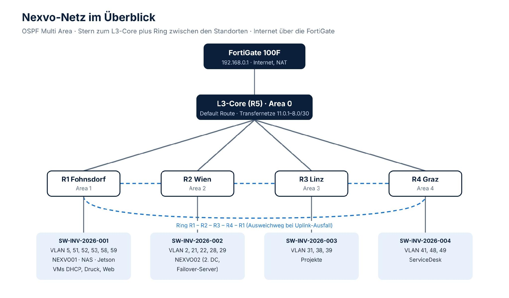
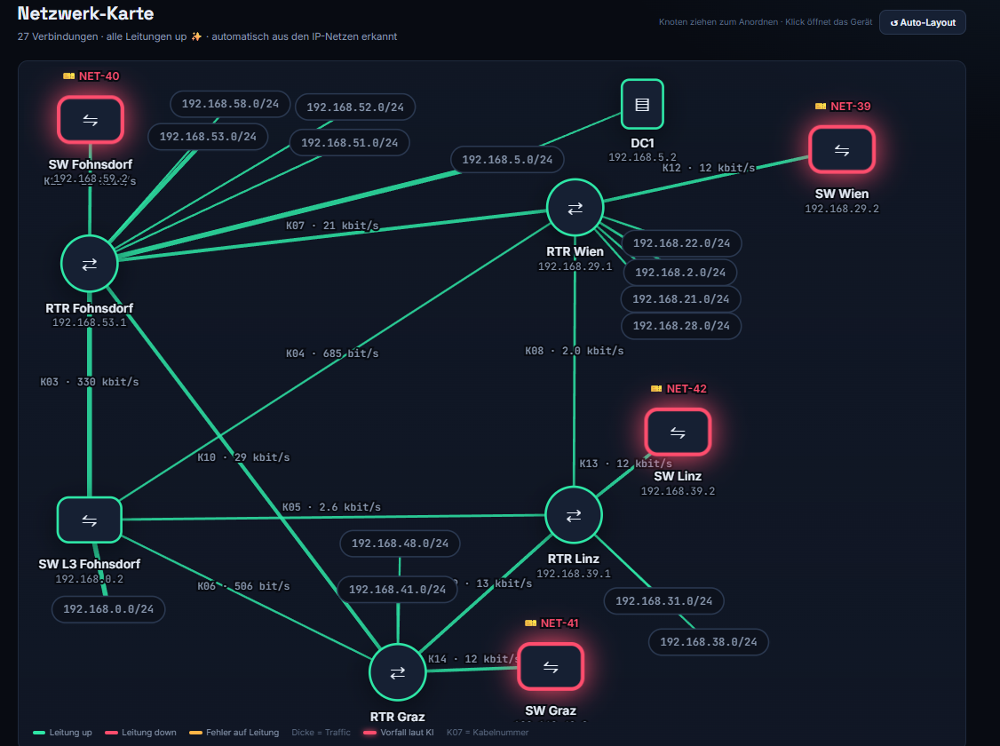
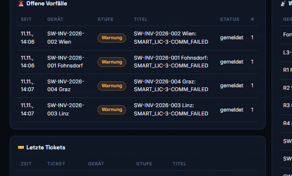
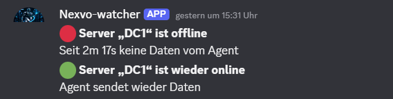
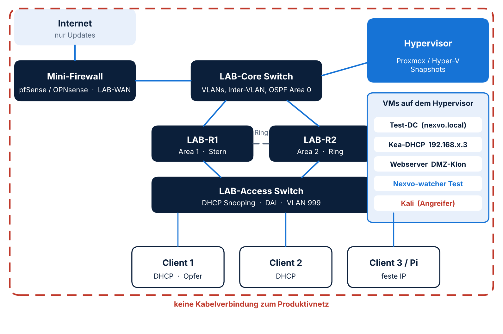

# 🌐 Nexvo GmbH · Firmennetz über vier Standorte

**Ausbildungsprojekt Netzwerktechnik · Schulungszentrum Fohnsdorf · 2026**

*Vier Standorte. Echte Hardware. Eigenes Monitoring mit lokaler KI.*

---

## 📖 Worum geht's?

Ein Team aus vier angehenden Netzwerktechnikern baut die komplette IT der fiktiven **Nexvo GmbH** auf: Verkabelung, VLANs, Routing, Firewall, Active Directory, Datensicherung, Failover, VPN und ein selbst entwickeltes Monitoring mit KI. Alles läuft auf **echter Hardware** im eigenen Server-Rack, nicht nur im Simulator.

## 📊 Auf einen Blick

| | |
|---|---|
| 🏢 **Standorte** | Fohnsdorf (Zentrale), Wien, Linz, Graz |
| 🔑 **Domäne** | nexvo.local |
| 🛡️ **Firewall** | FortiGate 100F mit LAN, WAN und DMZ |
| 🔀 **Netzwerk** | L3-Core, 4 × Cisco ISR 4431, 4 × Catalyst 9300 |
| 🧩 **VLANs** | 19, jede Abteilung mit eigenem Netz, DMZ, Parkplatz-VLAN 999 |
| 🗺️ **Routing** | OSPF mit 5 Areas, Stern plus Ring |
| 🖥️ **Server** | 2 Domänencontroller, 3 VMs unter Hyper-V, Synology NAS, NVIDIA Jetson |

## 🛠️ Technologien

| Bereich | Umsetzung |
|---|---|
| 🗺️ Routing | OSPF Multi-Area, Router-on-a-Stick, statische Routen auf der FortiGate |
| 🔀 Switching | 802.1Q-Trunks, Native VLAN 999, PortFast, BPDU Guard, DHCP Snooping |
| 🛡️ Firewall | FortiGate 100F, Zonen LAN, WAN und DMZ, Default Deny |
| ⚙️ Dienste | Active Directory, Kea DHCP mit Replikat, Druckserver, nginx mit HTTPS |
| 💾 Sicherung | Synology Active Backup und Hyper Backup, Hyper-V-Replikat nach Wien |
| 🔐 Zugang | SSH v2 mit ACLs, Tailscale als Subnet Router mit Split DNS |
| 📡 Monitoring | Nexvo-watcher (FastAPI, SNMP, Syslog, Config-Backups), Jetson mit lokaler KI, Jira, Discord |

## ✨ Highlights

### 🔁 Ausfallsicheres Routing
Jeder Standort-Router hängt am Core und zusätzlich in einem Ring. Fällt ein Uplink aus, rechnet OSPF den Weg neu und der Verkehr läuft über den Ring weiter.

### 🧱 DMZ für den Webserver
Der Webserver steht in einer eigenen Zone direkt an der FortiGate. Selbst wenn er gehackt würde, hat er keinen Weg ins interne Netz.

### 🚫 DHCP Snooping
Steckt jemand einen privaten Router an, verwirft der Switch dessen DHCP-Antworten. Der Vorfall landet sofort als Ticket in Jira.

### 🤖 KI-Monitoring mit eigenem Tool
Der **Nexvo-watcher** überwacht alle Geräte per Ping, SNMP und Syslog, zeichnet die Netzwerkkarte automatisch und sichert jede Nacht die Configs. Ein **NVIDIA Jetson** wertet die Logs mit festen Regeln und einem lokalen Sprachmodell aus, schreibt pro Vorfall genau ein Jira-Ticket und meldet über Discord.

<table>
<tr>
<td width="50%" align="center"><b>🚨 Offene Vorfälle</b>  </td>
<td width="50%" align="center"><b>💬 Alarm im Discord</b>  </td>
</tr>
</table>

### 🔒 VPN ohne einen offenen Port
Das Projektnetz liegt hinter mehreren NATs. Statt Portweiterleitung baut der Domänencontroller per **Tailscale** die Verbindung von innen nach außen auf und leitet als Subnet Router ins Projektnetz weiter.

### 🧪 Isolierte Testumgebung
Eine Kopie im Kleinen, ohne Kabel zum Produktivnetz. Hier werden Angriffe, Updates und Failover getestet, bevor etwas ins echte Netz geht.

## 👨‍💻 Meine Rolle

Ich, **Jakob Penitsch**, war im Team verantwortlich für:

| | Teilprojekt | Was ich gemacht habe |
|---|---|---|
| 🚫 | DHCP Snooping | Konzept, Konfiguration auf allen vier Switches, Test mit fremdem DHCP-Server |
| 🔐 | SSH und Zugänge | Härtung mit gerätebezogenen Benutzern und Zugriffslisten |
| 🔒 | VPN | Analyse per Traceroute, Tailscale als Subnet Router mit Split DNS |
| 🤖 | Monitoring | Entwicklung von Nexvo-watcher und KI-Jetson inklusive Jira und Discord |
| 🧪 | Testumgebung | Planung, Netzplan und Testplan |

## 💡 Was ich gelernt habe

| | |
|---|---|
| 🗺️ | Eine falsche OSPF-Wildcard kündigt nur halbe Netze an |
| 🛡️ | Eine Firewall ohne OSPF braucht nach jeder VLAN-Umstellung neue Rückrouten |
| 🚫 | Option 82 bei DHCP Snooping kann ganze Abteilungen ohne IP lassen |
| 🔒 | Ein VPN-Adapter, der sich im DNS registriert, kann die AD-Replikation lahmlegen |
| 🤖 | Eine KI im Monitoring darf nie allein entscheiden, sie braucht feste Regeln |
| 👥 | Wie man zu viert parallel baut und trotzdem eine einheitliche Doku hinbekommt |

## 📁 Aufbau des Repos

| Ordner | Inhalt |
|---|---|
| 📄 `docs` | Projektdokumentationen |
| ⚙️ `configs` | Anonymisierte Configs von Routern, Switches und Firewall |
| 🧰 `scripts` | Hilfsskripte, zum Beispiel Failover-Umschaltung |
| 📡 `monitoring` | Nexvo-watcher und KI-Jetson |
| 🧪 `testumgebung` | Testplan und Ergebnisse |
| 🖼️ `images` | Netzpläne und Screenshots |

---

🔏 *Alle Configs sind anonymisiert. Passwörter, Schlüssel, Tokens und Community-Strings sind durch Platzhalter wie `<PASSWORT>` ersetzt. Die Nexvo GmbH ist eine fiktive Firma für Ausbildungszwecke.*

**📬 Kontakt:** [GitHub](https://github.com/tscheky0)

